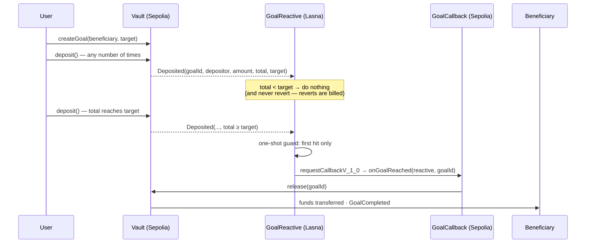

# GoalVault — Set It and Forget It, as a tool anyone can use

**Reactive Omni Buildathon · Track: "Set It and Forget It"**

> A no-code/low-code builder for Reactive automations. Pick a template, fill in a
> plain-language form, and deploy a vault that *finishes itself*: the moment its
> target is reached, Reactive Network releases the money — no keeper, no server,
> no cron job, and no button anybody has to remember to press.

---

## The problem

Almost every "automatic" payout in crypto is automatic in name only. A savings
goal fills up and then waits for someone to notice. An escrow is fully funded
and then waits for the client to press *release* — maybe today, maybe next
week, maybe after a dispute. A freelancer finishes the work and then chases
the payment. The missing piece is never the vault; it's a trustworthy watcher
that acts the *instant* a condition becomes true, without a server to keep
alive or a keeper to pay and trust.

## What GoalVault is

GoalVault is that watcher, packaged as a **tool, not a one-off automation**:

1. **A template engine on-chain** — small vault templates (Sepolia) + one reactive
   brain (Lasna) + one callback receiver (Sepolia). Every template speaks the
   same language: the same `Deposited` event, the same `release(id)` call.
2. **A low-code dashboard** (`dashboard/`, plain HTML/JS, no build step) — pick a
   template, answer plain questions ("Who should receive the money?", "How much
   is the target?"), see the exact deployment parameters generated from your
   answers, create the automation from your wallet, and manage everything in a
   "My Automations" view that reads live vault state from the Sepolia RPC.
3. **Templates anyone can extend** — a new automation type is a new thin vault
   implementing `IReleasableVault` plus a row in `TemplateRegistry`. The
   reactive engine and the dashboard's flow don't change.

### Templates

| # | Template | Contract | The automation |
|---|---|---|---|
| 1 | **Savings Goal** | `GoalVault.sol` | Save toward a target (laptop, trip, safety net). Fund it whenever; at 100% it pays the beneficiary automatically. |
| 2 | **Pay When Funded** | `EscrowVault.sol` | Client funds an escrow in instalments; the moment it's fully funded, the freelancer is paid — no release button to chase. |
| 3 | Threshold Alert | *(roadmap)* | Same engine, alert callback instead of a payout. |

## How it works



```
Sepolia                      Reactive Lasna                 Sepolia
─────────                    ──────────────                 ─────────
Vault.deposit() ──event──▶   GoalReactive.react() ──callback──▶ GoalCallback
  emits Deposited              checks total ≥ target              onGoalReached()
  (total AND target            (one-shot, on-chain)                     │
   travel inside the event)                                            ▼
                                                               Vault.release()
                                                               → beneficiary paid
```

Design decisions worth noting:

- **The target travels with the event.** A reactive contract cannot call
  Sepolia, so `Deposited` carries `(amount, total, target)` — `react()` is
  fully self-contained and never needs an oracle or a cross-chain read.
- **`react()` never reverts as a filter.** A reverting reaction is still billed
  in full on Reactive. Wrong topic, wrong vault, truncated data, below target —
  all fall through silently.
- **One-shot, provably.** `callbackSent[goalId]` guarantees at most one
  callback per goal, however many deposits arrive afterwards.
- **Two-layer callback authentication.** The callback proxy overwrites the
  payload's first argument with the reactive contract's address (we encode
  `address(0)` as the placeholder); the receiver checks *both*
  `onlyServiceProvider` (caller really is the proxy) and
  `onlyCallbackSender` (injected address really is our reactive contract,
  immutable since construction).
- **Omni, not Legacy.** System contract `0x8888…8888`,
  `SYSTEM.requestCallbackV_1_0(...)`, `onlySystem`, `reactive-lib-omni`,
  Solidity `^0.8.29`. No RVM, no `vmOnly`, no `Callback` event.

## Lifecycle & safety (audit-hardened)

Automations that run unattended need an off switch and a recovery path. This
system has all of them, on-chain:

- **Creator cancel & refund** — a goal's creator (or an escrow's client) can
  cancel *before completion*. Every contributor is credited exactly their own
  contribution as a pull balance (`pendingWithdrawals`, claimed via
  `withdraw()`) — per-depositor accounting means a refund can never touch
  another goal's funds. Cancellation is race-safe against an in-flight
  callback: deposits stop immediately, and `release()` refuses cancelled
  goals, so the payout cannot also happen.
- **Pause / resume** — the reactive contract's owner can `pause()` it, which
  unsubscribes at the system contract (no reactions, no billing) and
  `resume()` to re-subscribe with the exact same criteria. A broken
  automation can be stopped without redeploying anything.
- **Callback retry** — if a fired callback was never delivered on Sepolia
  (e.g. reserves ran dry mid-flight), the owner can `retryCallback(goalId)`.
  Safe by construction: the vault's `release()` is idempotent, and duplicate
  deliveries are absorbed by the callback contract.
- **Push-with-pull-fallback payouts** — if a beneficiary cannot receive ETH
  at the moment the callback lands, `release()` no longer reverts (which,
  with a one-shot reactive trigger, would have stranded the funds forever).
  The amount becomes a pull credit instead; the goal still completes.
- **Absorbing callback receiver** — `GoalCallback` wraps `release()` in
  try/catch and reports failures as `CallbackFailed` events rather than
  reverting the delivery: a reverting callback is still billed in full and
  repeated failures can push the contract into debt, halting all deliveries.
- **Reentrancy discipline** — checks-effects-interactions on every ETH path
  plus a hand-rolled reentrancy lock on `release()`/`withdraw()` in both
  vaults, proven by a malicious-beneficiary test that reenters mid-payout
  and still receives exactly the goal total, exactly once.
- **Zero-address discipline** — every constructor and wiring setter validates
  its addresses (a zero vault in `GoalCallback` previously made callbacks
  silently succeed while doing nothing; chain id `0` in `GoalReactive` is
  the ANY-chain subscription wildcard and is rejected).

## Repository layout

```
├── src/
│   ├── interfaces/IReleasableVault.sol   # the template contract: release(id)
│   ├── sepolia/GoalVault.sol             # Template #1 — Savings Goal (origin + funds)
│   ├── sepolia/EscrowVault.sol           # Template #2 — Pay-When-Funded escrow
│   ├── sepolia/GoalCallback.sol          # destination receiver (AbstractCallback)
│   ├── sepolia/TemplateRegistry.sol      # on-chain template catalogue
│   └── reactive/GoalReactive.sol         # the brain (AbstractReactive, on Lasna)
├── test/                                 # 58 tests, incl. a mock system contract
│   ├── GoalReactive.t.sol                #   etched at 0x8888…8888 + full-loop sims
│   ├── GoalVault.t.sol  GoalCallback.t.sol  FullLoop.t.sol  TemplateRegistry.t.sol
│   ├── AuditPOC.t.sol                    #   regression tests for the audit findings
│   ├── CancelRefund.t.sol  ReactiveLifecycle.t.sol  FuzzThreshold.t.sol
│   └── mocks/                            # MockSystemContract + hostile actors
├── dashboard/                            # the low-code layer (static, ethers v6 CDN)
│   ├── index.html  app.js  style.css
│   └── config.js                         # ← paste deployed addresses here
├── scripts/trigger.sh  collect-proof.sh  # demo driver + proof collector (deploy stage)
├── deployments.md                        # addresses + wiring checklist (filled, live)
└── PROOF.md                              # origin → reaction → callback tx trail (filled, live)
```

## Build & test

```bash
curl -L https://foundry.paradigm.xyz | bash && foundryup   # once
forge build
forge test
```

Current status: **`forge build` clean with zero lint warnings (solc 0.8.29),
`forge test` 58/58 passing**, including the three behaviours the whole system
stands on — below target ⇒ no callback request; at/above target ⇒ exactly
one callback request with the correctly encoded payload; further deposits ⇒
no second callback (one-shot guard) — plus full-loop simulations for *both*
templates through the same engine, both callback-authentication failure
modes, cancel/refund accounting (unit + fuzz), pause/resume/retry lifecycle,
reentrancy and payout-failure actors, and fuzzed deposit sequences proving
the callback fires exactly once, exactly at the crossing deposit.

## Run the dashboard

```bash
cd dashboard && python3 -m http.server 8080   # or any static server / file host
# open http://localhost:8080
```

No build step, no server-side code. Reads work without a wallet; creating and
funding automations uses your own wallet on Sepolia. Until addresses are pasted
into `dashboard/config.js`, the dashboard runs in **preview mode** (builder +
generated parameters live, on-chain creation disabled) — and if a script or
the ethers CDN fails to load, it now degrades to a clear notice instead of a
dead page. The dashboard also shows a **Reactive status** panel (Lasna chain
check, system-contract and per-template reactive/callback/vault explorer
links, paused/live state), a per-automation **Cancel & refund** button for
the connected creator wallet, and a refund bar for claiming pull credits
(`pendingWithdrawals`) via `withdraw()`.

## Deploy (EXECUTED 2026-11-17 — live on Sepolia + Lasna, see PROOF.md)

Full, ordered commands live in `../BUILD-PLAN.md` §4.4 and the checklist in
[deployments.md](deployments.md). The order is load-bearing:

1. Fund a fresh testnet-only deployer: Sepolia ETH, then lREACT via the faucet
   contract `0x9b9BB25f1A81078C544C829c5EB7822d747Cf434` (1 ETH → 100 lREACT).
2. Deploy `GoalVault` + `EscrowVault` (+ `TemplateRegistry`) on Sepolia.
3. Deploy `GoalReactive` ×2 on Lasna — the constructor subscribes to each vault's
   `Deposited` topic0 `0x893e8a14c42d0303c66e296f4c3e4ed772edf8097f8d41ab8d08099654172ec0`.
4. Fund each reactive contract via `SYSTEM.depositTo(reactive)` (~1 lREACT).
5. Deploy `GoalCallback` ×2 on Sepolia with `(Sepolia proxy
   0xAa14d9Cd0f788Ca23d11805986C1d8bd035D23b4, reactive address, vault)` —
   the reactive address is immutable here; a mistake means redeploy.
6. Fund each callback via the proxy's `depositTo(callback)` (~0.1 Sepolia ETH).
7. Wire the cycle: `reactive.setRecipient(callback)`, `vault.setExecutor(callback)`
   (one-time), register both templates.
8. Verify `debt() == 0` on both sides, verify sources (Sourcify), paste the
   addresses into `dashboard/config.js`, then run `scripts/trigger.sh` and
   record the three proof hashes in [PROOF.md](PROOF.md).

## Deployed addresses & proof

| Item | Address / hash |
|---|---|
| GoalVault (Sepolia) | `0x974465f83CC332810d475b1092F96A4376434eCD` |
| EscrowVault (Sepolia) | `0x942e0d1cCB31B6C4a12E6b479D6F406C644DeE8E` |
| GoalReactive for GoalVault (Lasna) | `0x24dB62b02e0D6Fd5863ab554e08aE61A44604e0D` |
| GoalReactive for EscrowVault (Lasna) | `0x974465f83CC332810d475b1092F96A4376434eCD` (same string as GoalVault — different chain, same deployer nonce) |
| GoalCallback for GoalVault (Sepolia) | `0xfC568793c7f2a04178F4809c10312D98E61e33f1` |
| GoalCallback for EscrowVault (Sepolia) | `0xc772B94E8f61A3BF98A450a85aB11606190432D0` |
| TemplateRegistry (Sepolia) | `0x4a30CD68D2046E37f3f8cF81431d743c0b227400` |
| Proof: origin tx → reactive tx → callback tx | `0x34237a26…52ef3` → `0x134498f8…30e0` → `0xdb51a119…a892` — full trail for both templates in [PROOF.md](PROOF.md) |

## Networks

| Role | Network | Chain ID | Explorer |
|---|---|---|---|
| Origin + destination | Ethereum Sepolia | 11155111 | https://sepolia.etherscan.io |
| Reactive | Reactive Lasna | 5318007 | https://lasna.reactscan.net |

## License

MIT (contracts in this repo). `reactive-lib-omni` is © Reactive Network,
used via its official repository as a Foundry dependency.
